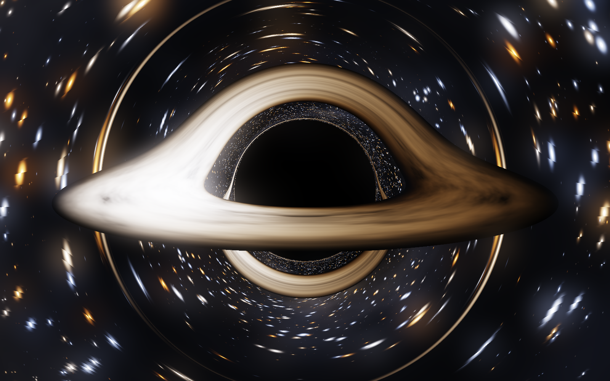
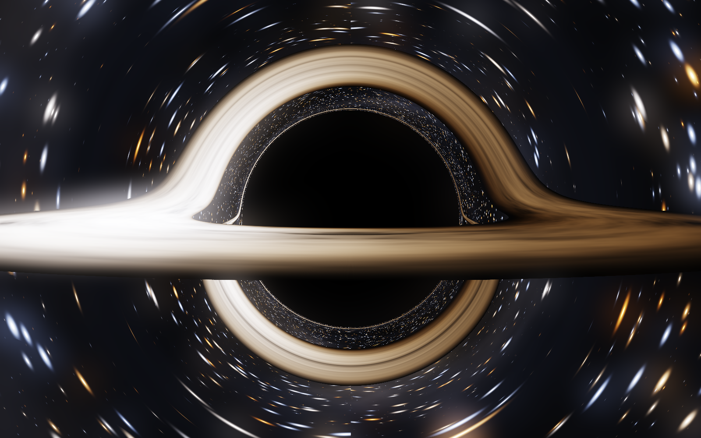
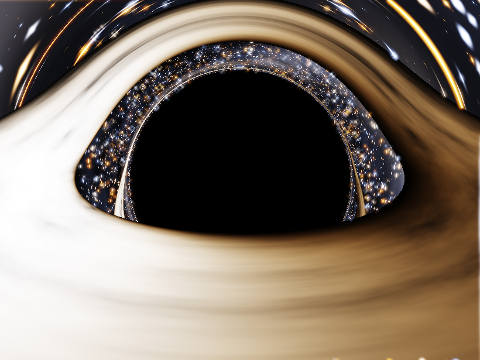

# Schwarzschild — a general-relativistic black-hole ray tracer

A real-time, physically-derived black hole. Every pixel integrates a **null
geodesic of the Schwarzschild metric** on the GPU; the image is what general
relativity says you would actually see, not an artist's impression.

**Open [`blackhole.html`](blackhole.html)** in any WebGL2 browser. Single file,
no build step, no dependencies.



*Observer at r₀ = 40M, inclination 80°. The disk's far side is lensed up over the
shadow, the near side is bent down beneath it, and the photon ring traces the
capture boundary. The left limb approaches and is beamed blue-white; the right
limb recedes and is dimmed and reddened.*

<p align="center">
  
  
</p>

*Left: a near edge-on pass at r₀ = 22M, where the disk collapses to a thin line
and both lensed images of its far side wrap under the shadow. Right: a close
orbit at r₀ = 16M, inside the strong-field regime.*

---

## What is actually being computed

Geometrized units, `G = c = M = 1`, so `r_s = 2M`.

Null geodesics are planar. In the orbital plane, with `u = 1/r` and `φ` the
angle measured from the camera's radial direction, the exact geodesic equation is

```
d²u/dφ²  =  −u + (3/2) r_s u²
```

integrated per pixel with adaptive-step RK4. The first integral

```
(du/dφ)²  =  1/b² − u²(1 − r_s u)
```

fixes the impact parameter `b` from the initial conditions. From the trajectory
the renderer derives, with no free parameters:

| effect | how it is obtained |
|---|---|
| gravitational lensing, photon ring, higher-order disk images | the geodesic integration itself |
| black-hole shadow | rays whose `b < 3√3 M` are captured |
| Doppler beaming + shift | `g = 1 / [√(1−r_s/r₀) · u^t · (1 − Ω L_z/E)]` |
| gravitational redshift | the `√(1−r_s/r₀)` factor in the same expression |
| disk colour and brightness | observed spectrum is a blackbody at `g·T`; colour from its CIE chromaticity, brightness from its **visible** luminance |
| disk temperature | Shakura–Sunyaev `T(r) ∝ (r_in/r)^{3/4}(1−√(r_in/r))^{1/4}` |
| shear | turbulence advected at the local Keplerian rate `Ω ∝ r^{−3/2}` |

The camera is a **static observer**, not a Newtonian pinhole. Its orthonormal
frame gives the initial conditions

```
b = r₀ sin ψ / √(1 − r_s/r₀)          du/dφ|₀ = −cos ψ √(1 − r_s/r₀) / (r₀ sin ψ)
```

Dropping that `√(1−r_s/r₀)` is a subtle, plausible-looking error that inflates
the shadow by up to ~7% at `r₀ = 15M`. The end-to-end test below catches it.

---

## Verification

The physics was validated against independent analytic results *before* being
ported to GLSL. Run it yourself:

```
python ref/grbh.py --validate-only
```

**1 — Light deflection, three independent methods** (`α` in radians).
RK4 integration vs. Gauss–Legendre quadrature of the first integral (a
different formulation, with the `1/√(u₁−u)` endpoint singularity removed by
substitution) vs. the Keeton–Petters strong-deflection series:

```
     b/M   RK4 geodesic    exact quadrature     PN series    |ΔRK4|
     5.5    2.553020175      2.553020185    1.737225874   9.26e-09
     8.0    0.858730012      0.858730018    0.834586398   5.42e-09
    20.0    0.236135948      0.236135995    0.236088276   4.70e-08
   100.0    0.041222589      0.041222539    0.041222537   4.98e-08
  1000.0    0.004011935      0.004011825    0.004011824   1.09e-07
```

The residual is round-off, not truncation: refining the step does not move it.
(The PN series is only asymptotic — its ~1% offset at `b = 5.5M` is the series
diverging, not the integrator failing.)

**2 — Critical impact parameter.** The capture threshold is where the first
integral has a double root, `max_u[u² − 2Mu³] = 1/b²` at `u = 1/3M`. Bisecting
the RK4 capture boundary against that:

```
b_crit by bisection : 5.196152423 M
exact 3√3 M         : 5.196152423 M      rel. err 5.6e-13
photon sphere from u''=0 : 3.000000000 M (exact 3)
```

**3 — End-to-end shadow radius.** A static observer at `r₀` sees the shadow at

```
sin θ_sh = b_crit √(1 − r_s/r₀) / r₀
```

measured from the actual rendered capture boundary:

```
     r₀/M     measured       analytic       rel.err
     12.0    23.280745°    23.283732°     1.28e-04
     20.0    14.266481°    14.269027°     1.78e-04
     40.0     7.272851°     7.274005°     1.59e-04
    100.0     2.945473°     2.948555°     1.05e-03
```

The residual is pixel discretisation. **This test is what found the missing
`√(1−r_s/r₀)`**: it originally read 6.8e-2 at `r₀ = 15M`.

---

## The file layout

```
blackhole.html     the deliverable — open this
ref/grbh.py        CPU reference implementation + the validation suite
ref/diag.py        per-pixel ray-fate diagnostics (captured / sky / disk)
ref/stills.py      renders the high-resolution stills
ref/sweep.py       parameter sweep -> contact sheet
out/               rendered stills
```

`ref/grbh.py` is the blueprint: every function in it has a 1:1 GLSL
counterpart, which is why the shader could be trusted before it was ever run.

---

## Controls

Drag to orbit · scroll to change `r₀` · shift-drag to zoom · `h` hide UI ·
`space` animate the disk shear · `r` reset · `s` save a PNG.

The disk is sheared by relativistic Keplerian motion, so the turbulence visibly
winds up as time advances. The renderer accumulates progressively-jittered
samples when the camera is still, and drops resolution while you drag.

State is shareable through the URL — every control has a query parameter:

```
blackhole.html?r0=22&inc=87&fov=50&q=ultra&expo=0.55&bloom=0.30&hideui=1
```

`r0 inc fov az rout tscale diskGain time expo bloom starGain skyGain`
`q=low|med|high|ultra  disk sky doppler grav anim hideui diag`

## What is *not* modelled

Kerr rotation (this is Schwarzschild — no frame dragging, no spin), disk
self-illumination and returning radiation, Compton scattering, and a
self-consistent disk atmosphere. The disk is optically thick and geometrically
thin, radiating locally as a blackbody.
